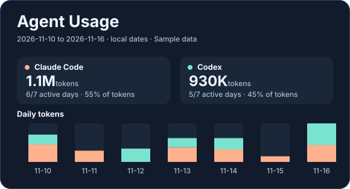

# Agent Usage Card

A shareable GitHub profile card for your last seven days of Claude Code and Codex CLI usage.



## Quick start

Install Node.js 24 with npm, then run:

```sh
git clone https://github.com/MinSang22Kim/agent-usage-card.git
cd agent-usage-card
node card.mjs --demo
```

This writes `agent-usage.svg` using sample data. To generate a card from the CLI logs on your machine:

```sh
node card.mjs
```

The first live run downloads the pinned [ccusage](https://github.com/ccusage/ccusage) package through npm. ccusage then summarizes local usage with offline price lookup and cost reporting disabled. The card contains daily token totals, usage days, and token shares for Claude Code and Codex. It does not include prompts, costs, project paths, or model names. Review the card before committing it to a public repository.

## Add it to your profile

Copy `agent-usage.svg` into your GitHub profile README repository and add this line to its README:

```md

```

Run the same command on your computer whenever you want to refresh it. To write straight to your profile checkout, pass `--out` with the destination path:

```sh
node card.mjs --out "../YOUR-USERNAME/agent-usage.svg"
```

Days use your computer's local time zone and include today. Only usage present in the local CLI logs can be counted, and totals reflect the token categories reported by ccusage. ChatGPT website usage and subscription limits are outside this card's scope.

## Sync two Windows PCs to a pinned Gist

`sync-usage.ps1` uploads date-level token totals from each PC to a private
repository, then the home PC combines them into the pinned Agent Usage Gist.
It uses GitHub CLI with repository and Gist access, Node.js 24, and local CLI logs.
Each PC owns one snapshot, so repeated runs do not add the same day twice.
Keep copied CLI sessions on only one reporting PC to avoid counting them twice.

Create a public Gist with one file named `Agent Usage.txt` and pin it to your profile.
Use the ID of your own Gist and create a dedicated private repository once.
The commands below show this project owner's configuration.

```powershell
gh repo create MinSang22Kim/agent-usage-data --private --add-readme
Unblock-File .\sync-usage.ps1
```

Run once in Windows PowerShell on the home PC:

```powershell
powershell.exe -NoProfile -ExecutionPolicy RemoteSigned -File .\sync-usage.ps1 -StorageRepo MinSang22Kim/agent-usage-data -Device home -GistId 2a51adc3683f7794329cc56954a691f7 -Publish
```

Run once in Windows PowerShell on the work PC:

```powershell
Unblock-File .\sync-usage.ps1
powershell.exe -NoProfile -ExecutionPolicy RemoteSigned -File .\sync-usage.ps1 -StorageRepo MinSang22Kim/agent-usage-data -Device work
```

The installation replaces the existing Agent Usage Gist scheduled task on each
PC. It runs at Windows sign-in and at 09:00 local time. Only the home PC publishes
the public Gist; changes from the work PC appear on the next home run. Use
`Start-ScheduledTask -TaskName 'Agent Usage Gist'` on the home PC to refresh
immediately after the work PC has synced.

Weekly tokens cover today and the previous six days in Korea time. Total tokens
cover all locally observed usage and previously synced days. Per-device daily
values keep the highest observed count, so later log cleanup does not lower past
totals. Historic logs that were never synced cannot be reconstructed. The public
Gist contains the combined totals and the number of reporting PCs.
